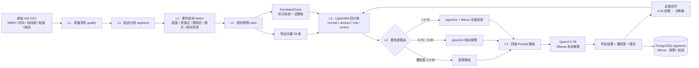

# ⚓ 智海巡航 — 港口船舶违规行为智能识别平台

> 基于 **三级级联架构** 的 AIS 船舶数据智能分析系统：`AIS 加速器 → ML Triage 路由 → LLM 判定`，配套 Web 管理系统。

[]()
[]()
[]()
[]()
[]()
[]()

---

## 📖 项目简介

**智海巡航** 是一个面向海事监管的 **AIS（船舶自动识别系统）数据违规检测平台**。它读取海量原始船舶轨迹 CSV 数据，自动识别**超速、禁渔区捕捞、限制区闯入、AIS 信号中断、航向异常**等违规行为，并生成风险等级、证据链与处置建议。

系统采用**三级级联架构**，把昂贵的 LLM 推理用在刀刃上：

```
原始 AIS 数据
    │
    ▼
┌─────────────────────────────────────────┐
│ L1 · AIS 数据加速器  ais_accelerator     │  ← 规则引擎，毫秒级，标记全部可疑行为
│      质量清洗 → 分段 → 事件检测 → 压缩     │
└──────────────────┬──────────────────────┘
                   │ 特征向量 + 标记轨迹
                   ▼
┌─────────────────────────────────────────┐
│ L2 · ML Triage 路由  triage_engine       │  ← LightGBM 四分类，微秒级，分流
│      正常 / 明显问题 / 有风险 / 需审查      │
└──────────────────┬──────────────────────┘
                   │ 路由指令 + 相似案例
                   ▼
┌─────────────────────────────────────────┐
│ L3 · LLM 判定层  llm_layer               │  ← Qwen2.5 本地推理，秒级，最终裁决
│      四级 Prompt 模板 + 反馈闭环           │
└──────────────────┬──────────────────────┘
                   ▼
            判定结果 + 置信度 + 建议 → 违规管理 / 数据上传
```

每一层只处理上一层「筛出来的可疑子集」，**加速器过滤 99% 正常数据、ML 只让低置信度案例走 LLM**，从而在准确率、时延、Token 成本之间取得平衡。LLM 判定结果又通过**反馈闭环**回流为 ML 的训练数据，让模型**越用越准、LLM 越用越少**。

---

## ✨ 功能特性

### 三级级联引擎

| 级别 | 模块 | 技术 | 定位 |
|------|------|------|------|
| **L1** | `ais_accelerator/` | Python 规则引擎 + Pydantic | 数据清洗、轨迹分段、候选事件检测、规则预筛、特征提取 |
| **L2** | `triage_engine/` | LightGBM + pgvector + Milvus | 四分类路由、置信度分级、相似案例召回 |
| **L3** | `llm_layer/` | Qwen2.5:7B（Ollama 本地） | 四级 Prompt 深度判定、法规引用、反馈提取 |

### 核心能力

- 🧭 **Recall-first 召回优先** —— 加速器宁可误报不漏报，所有不确定性留给 LLM 终裁，证据链完整可追溯
- 🔁 **反馈闭环持续学习** —— LLM 结果自动回流训练集，LightGBM 增量更新，系统自进化
- 🧠 **智能体记忆系统** —— 会话记忆（进程内）+ 船舶记忆（惯犯识别，SQLite）；情景记忆（PatternMemory）已实现，当前服务于 ShipClaw 智能体，不进检测管道
- ⚓ **ShipClaw 可养成海事智能体「级联监管者」** —— Lv1~10 等级、四维性格、技能系统（法规问答 / 船舶查询 / **违规证据链** / 趋势分析 / 碰撞预警 / 闲聊）
- 🌐 **Web 管理系统** —— Vue 3 仪表盘 / 船舶监控 / 违规管理 / 级联日志 / AI 对话（文书上报页当前仅展示违规列表，处置后端未接入）
- 📜 **法规向量数据库** —— `RegulationDB` 将法规条款向量化，LLM 判定时注入具体条款，输出 `regulation_ref` 供前端展示
- 🗄️ **双向量库** —— 结构化特征向量存 `pgvector`，轨迹序列向量存 `Milvus`，各取所长
- 🛡️ **优雅降级** —— 无 LLM / 无 Milvus / 无 pgvector 时系统照常运行，自动重试与安全默认值

---

## 🏗️ 架构总览



### 三级职责对比

| 维度 | L1 加速器 | L2 ML 路由 | L3 LLM 判定 |
|------|-----------|------------|-------------|
| 职责 | 清洗 + 打标记 + 特征提取 | 四分类路由 + 相似召回 | 最终裁决 + 深度解释 |
| 处理方式 | 确定性规则，0% 丢数据 | 概率模型，持续进化 | 大模型语义推理 |
| 数据量 | 全部原始数据 | 特征向量 | 路由后的可疑子集 |
| 性能 | 毫秒级 / 条 | 微秒级 / 条 | 秒级 / 条 |
| 成本 | 低 | 极低 | 高（Token 消耗） |

---

## 🛠️ 技术栈

| 分类 | 技术 |
|------|------|
| 后端 | Python 3.10+ · Flask 3 |
| 前端 | Vue 3 · Vite · ECharts · Leaflet |
| ML | LightGBM（四分类 + 增量训练） |
| 向量库 | PostgreSQL + pgvector（特征向量） · Milvus（轨迹序列） |
| LLM | Ollama · Qwen2.5:7b-instruct-q4_K_M |
| 存储 | SQLite（Web 运行时 / 记忆） · PostgreSQL（案例库） |

---

## 🚀 快速开始

### 🐳 Docker 一键部署（推荐给其它开发者）

无需安装 Python / Node / Ollama，只需 Docker Desktop，一条命令跑起全套：

```bash
cp .env.example .env         # 可选：改 SECRET_KEY / ADMIN_PASSWORD / 端口
docker compose up -d --build
# 打开 http://localhost:5000 （默认管理员 admin / admin123）
```

没有本地模型的用户，首次启动会自动拉取 LLM 模型（qwen2.5:7b-instruct-q4_K_M + nomic-embed-text），进度见 `docker compose logs -f ollama`；**已有模型的部署方可直接自带**（拉取失败不阻塞，app 自动降级，详见 [docs/DOCKER.md](docs/DOCKER.md)）。
向量库（Milvus 三件套）默认随完整栈启动，法规语义检索 / 轨迹相似检索开箱即用（详见 [docs/DOCKER.md](docs/DOCKER.md)）。

### 手动安装

> 完整安装与配置详见 [docs/QUICKSTART.md](docs/QUICKSTART.md)。

**前置依赖：** Python 3.10+ · Ollama · Docker（Milvus / pgvector）· Node.js 18+

```bash
# 1. 启动 Ollama 并拉取模型
ollama pull qwen2.5:7b-instruct-q4_K_M

# 2. 启动 Milvus（Docker）与 PostgreSQL + pgvector 容器
#    （连接地址可在 config.py 或环境变量中配置）

# 3. 安装 Python 依赖
pip install lightgbm numpy pymilvus langchain-ollama pydantic psycopg2-binary

# 4a. 一键启动 Web 管理系统（推荐）
python start.py                 # 访问 http://localhost:5000

# 4b. 或使用 CLI 全链路分析
python run.py                   # 处理 data/input/ 下所有 CSV
python run.py -i data/input/xxx.csv -n 10 --no-llm
```

---

## 📂 项目结构

```
E:\AIS\
├── run.py                  # 🚀 三级级联全链路 CLI 运行（唯一数据处理管道）
├── start.py                # 🌐 Web 服务统一启动入口（Flask + Vue 静态文件）
├── orchestrator.py         # ⚙️ 三级级联主编排器 EndToEndOrchestrator
├── cascade_agent.py        # 🧩 统一入口：调用 run.py 并捕获日志到 cascade_logs
├── config.py               # 🔧 全局配置（Milvus / PostgreSQL 连接）
├── project.py              # 项目根路径常量
│
├── ais_accelerator/        # ⚡ L1 · AIS 数据加速器
│   ├── facade.py           #   外观模式统一接口
│   ├── pipeline.py         #   管线编排
│   ├── models.py           #   Pydantic 数据模型
│   ├── quality.py          #   数据质量清洗
│   ├── segment.py          #   轨迹分段
│   ├── detect.py           #   候选事件检测
│   ├── merge.py            #   事件合并
│   ├── compress.py         #   RDP 轨迹压缩
│   ├── rules.py            #   规则预筛
│   ├── predict.py          #   轨迹预测
│   ├── collision.py        #   碰撞风险评估
│   ├── regulation_db.py    #   法规向量数据库
│   └── annotator.py        #   轨迹标注器
│
├── triage_engine/          # 🧠 L2 · ML Triage 路由引擎
│   ├── router.py           #   路由决策（四分类 + 置信度阈值）
│   ├── model.py            #   LightGBM 模型封装
│   ├── train.py            #   初始 / 增量训练
│   ├── milvus_client.py    #   Milvus 客户端
│   ├── pgvector_client.py  #   PostgreSQL + pgvector 客户端
│   └── schema.sql          #   pgvector 建表 SQL
│
├── llm_layer/              # 🤖 L3 · LLM 判定层
│   ├── handler.py          #   LLM 调用处理器（Qwen2.5 / Ollama）
│   ├── prompts.py          #   四级 Prompt 模板
│   └── feedback.py         #   反馈闭环 + 增量训练
│
├── memory/                 # 🧠 智能体记忆系统
│   ├── session_memory.py   #   会话记忆（进程内，跑完丢弃）
│   ├── ship_memory.py      #   船舶记忆（SQLite 持久化，惯犯识别）
│   └── pattern_memory.py   #   情景记忆（SQLite 相似度匹配）
│
├── shipclaw/               # ⚓ 可养成海事智能体「小慧」
│   ├── core.py             #   ShipClaw 主类（对话 / 技能 / 成长）
│   ├── personality.py      #   四维性格系统
│   ├── skills.py           #   技能系统（法规问答 / 船舶查询 / 趋势分析…）
│   └── claw_memory.py      #   养成记忆（持久化用户偏好）
│
├── frontend/frontend/      # 🌐 Web 前端 + 后端
│   ├── src/                #   Vue 3 源码（Dashboard / ShipMonitor / ReportDocuments…）
│   └── backend/app.py      #   Flask 后端 API（/api/v1 约 62 个端点）
│
├── database/schema.sql     # 🗄️ PostgreSQL + pgvector 建表 SQL（核心案例库）
├── regulations.json        # 法规区域 / 船型配置
├── experiments/            # 🔬 对比实验（架构对比 + 反馈闭环）
├── scripts/                # 数据导入 / 初始化 / 法规种子脚本
├── data/                   # 📊 输入 / 输出 / 缓存 / 日志 / SQLite / LLM 配置
├── docs/                   # 📚 设计与使用文档
└── 论文/                    # 📄 论文研究方案（方向 A：三级级联成本-质量帕累托）
```

---

## 🔌 API 概览

后端提供 `/api/v1` REST API（约 62 个端点），覆盖：用户认证、仪表盘统计、船舶轨迹监控、违规管理、AI 对话、ShipClaw 养成、级联日志、数据上传与检测结果、区域分析、开发者配置、用户资料、管理员与组织管理。

| 分组 | 前缀 | 说明 |
|------|------|------|
| 认证 | `/api/v1/auth/*` | 注册 / 登录 / 登出 / 会话状态 |
| 仪表盘 | `/api/v1/dashboard/*` | 统计 / 流量趋势 / 违规分布 / 预警 |
| 船舶 | `/api/v1/ships/*` | 船舶列表 / 轨迹 / 航速统计 |
| 违规 | `/api/v1/violations/*` | 违规列表 / 详情 |
| AI | `/api/v1/ai/*` | 智能体资料 / 聊天 / 工具目录 / 数据查询 |
| ShipClaw | `/api/v1/claw/*` | 状态 / 性格 / 成长日志 / 偏好 |
| 级联 | `/api/v1/cascade/*` | 检测统计 / 级联日志 / 准确率 |
| 数据 | `/api/v1/data/*` | CSV 上传 / 检测结果 / 用户统计 |
| 区域 | `/api/v1/zone/analyze` | 区域行为分析 |
| 开发者 | `/api/v1/dev/*` | 模型提供商 / 用途绑定 / 可执行插件 |
| 用户 | `/api/v1/user/*` | 个人资料 / 密码 / 头像 |
| 管理 | `/api/v1/admin/*` | 用户列表 / 角色分配（仅超级管理员） |
| 组织 | `/api/v1/orgs/*` | 组织 CRUD / 成员管理 |

完整接口文档见 [docs/API.md](docs/API.md)。

---

## 📚 文档导航

| 文档 | 说明 |
|------|------|
| [docs/QUICKSTART.md](docs/QUICKSTART.md) | 环境准备、安装配置、常见问题 |
| [docs/API.md](docs/API.md) | REST API 完整参考 |
| [docs/DESIGN.md](docs/DESIGN.md) | 三层级联架构设计（含消融实验方案） |
| [docs/数据库设计方案.md](docs/数据库设计方案.md) | 数据库 E-R 设计与表结构 |
| [docs/智能体记忆系统设计.md](docs/智能体记忆系统设计.md) | 记忆系统设计与实现 |
| [docs/实验方案.md](docs/实验方案.md) | 对比实验与消融方案 |
| [论文/方案A_三级级联论文方案.md](论文/方案A_三级级联论文方案.md) | 📄 论文研究方案（方向 A） |

---

## 🧪 实验与验证

`experiments/` 内置两套实验框架：

**① 架构对比实验**（`experiments/run.py`）—— 量化**三级级联架构**相对**原始 4-Agent** 的优势：

- ⚡ **速度实验** `--speed` —— LLM 调用次数、墙钟时间、可扩展性（1 / 10 / 50 / 100 船）
- 📈 **实用性实验** `--practicality` —— 容量压力测试 + 证据链完整性 + 压缩率
- 🛡️ **容错实验** `--fault-tolerance` —— 故障注入：无 Ollama / 无 ML 模型 / 无 Milvus / 脏数据 / 组合故障

```bash
python experiments/run.py --speed --practicality --fault-tolerance
# 结果输出到 experiments/results/run_<timestamp>/（experiment_report.md / 图表 / 汇总 CSV）
```

**② 反馈闭环实验**（`experiments/feedback_experiment/`）—— 验证 LLM 结果回流为 ML 训练数据的效果：

- 实验 A：ML vs LLM 分歧率摸底
- 实验 B：`RETRAIN_THRESHOLD` 阈值扫描（5–50）
- 实验 C：反馈有无 A/B 对照（Bootstrap 多轮）

```bash
python -m experiments.feedback_experiment.run --report-only
# 结果输出到 experiments/feedback_experiment/results/
```

> ⚠️ 反馈实验结论：当前效果量弱（分歧率约 1–2%、阈值 5–40 全 +0.00% 提升），且存在「LLM 教 LLM」的循环 ground truth 问题。**要作为论文实验需重建人工标注 GT 与基线**，详见 [论文/方案A_三级级联论文方案.md](论文/方案A_三级级联论文方案.md)。

---

## 🧭 设计原则

1. **召回优先（Recall-first）** —— 加速器宁可误报也不漏报，不确定性留给 LLM 终裁
2. **可追溯** —— 每个标记都带来源模块、置信度、严重程度，形成完整证据链
3. **优雅降级** —— 任何一层故障（无 LLM / 无数据库 / 无模型）都不中断整体流程
4. **模块独立** —— 三层各自可独立使用、独立测试（`orchestrator.run_pipeline_only` / `run_with_ml` / `run_full`）
5. **记忆增强** —— 记忆系统让判定「越用越准」，而不是每艘船都从零判断

---

## 🤝 参与贡献

欢迎提交 Issue 与 Pull Request，详见 [CONTRIBUTING.md](CONTRIBUTING.md)。

## 📝 更新日志

主要里程碑见 [CHANGELOG.md](CHANGELOG.md)。
